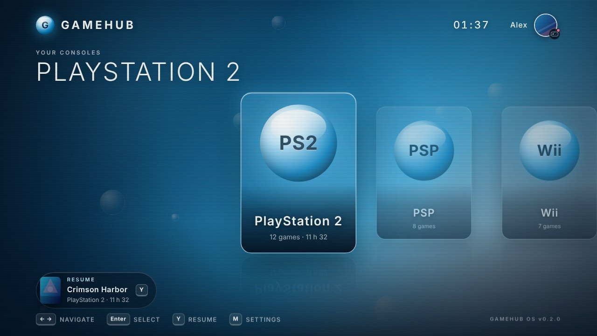
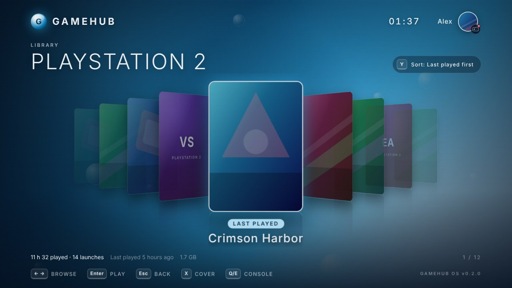

# GameHub

Un écran d'accueil façon console pour tes émulateurs. Tu ajoutes tes consoles une fois, et GameHub te donne une bibliothèque claire, pensée pour la manette, qui lance le bon émulateur avec le bon jeu.

[Read in English](README.md)



## Fonctionnalités

- **Un seul accueil pour toutes tes consoles.** Chaque console garde son émulateur, son dossier de jeux et ses options de lancement.
- **Des modèles pour les émulateurs courants.** PlayStation 1/2/3, PSP, GameCube, Wii, Xbox 360, Nintendo 64/DS, Game Boy Advance et Super Nintendo arrivent avec des types de fichiers et des options de lancement adaptés.
- **La bibliothèque se construit toute seule.** GameHub analyse tes dossiers, nettoie les titres, masque les fichiers `.bin` rattachés à un `.cue` et garde les jeux multi-disques séparés.
- **Pensé pour la manette et le clavier.** Tout se pilote à la manette, au clavier ou à la souris. Les aides en bas d'écran s'adaptent à l'appareil que tu utilises.
- **Jaquettes, profil, statistiques.** Ajoute tes jaquettes, une photo de profil et une bannière, et suis ton temps de jeu.
- **Quatre thèmes, deux langues.** Océan, Matrix, Cyberpunk et Minuit. Français et anglais, choisis d'après ton système par défaut.
- **Sûr par conception.** L'interface n'envoie jamais le chemin d'un programme au backend : elle demande seulement de lancer « ce jeu de cette console ». L'émulateur et ses arguments viennent toujours de tes réglages enregistrés, et un chemin de jeu ne peut pas sortir du dossier de la console.
- **Données portables.** Réglages, jaquettes et statistiques tiennent dans un seul dossier, à copier pour les sauvegarder.



## Installation

### Depuis une release

Télécharge l'installateur pour ton système sur la page [Releases](../../releases) et lance-le.

GameHub ne contient aucun jeu, aucun BIOS et aucun émulateur. Installe d'abord les émulateurs que tu veux utiliser, puis ajoute-les dans GameHub.

### Depuis les sources

Il te faut [Node.js 22.12 ou plus récent](https://nodejs.org), [Rust](https://rustup.rs) et les [prérequis Tauri](https://tauri.app/start/prerequisites/) de ton système. Windows est la cible principale.

```bash
npm install
npm run tauri dev      # lancer l'application de bureau
npm run tauri build    # construire un installateur
```

`npm run dev` seul démarre l'interface dans un navigateur classique, avec un backend de démonstration et des jeux inventés. C'est le moyen le plus rapide de travailler sur le design.

## Premiers pas

1. Ouvre GameHub et choisis **Ajouter une console**.
2. Choisis un modèle (ou **Personnalisée**), puis le programme de l'émulateur et le dossier qui contient tes jeux.
3. Appuie sur **Ajouter la console**. Tes jeux apparaissent dans la bibliothèque.
4. Sélectionne un jeu et appuie sur <kbd>Entrée</kbd> (ou **A** à la manette).

### Options de lancement

Les options de lancement sont les arguments passés à l'émulateur. Écris `{rom}` à l'endroit où le fichier du jeu doit aller :

```text
-batch -fullscreen -- {rom}
```

Si `{rom}` manque, le chemin du jeu est ajouté à la fin. Les guillemets gardent ensemble les arguments qui contiennent des espaces.

## Commandes

| Action | Clavier | Manette |
| --- | --- | --- |
| Se déplacer | Flèches ou WASD | Croix ou stick gauche |
| Valider | Entrée | A |
| Retour | Échap | B |
| Changer la jaquette / réinitialiser | X | X |
| Trier / reprendre le dernier jeu | Y | Y |
| Console précédente / suivante | Q / E | LB / RB |
| Réglages | M | Start |
| Plein écran | F11 ou Alt+Entrée | |

## Tes données

Tout ce que GameHub enregistre est dans le dossier `GameHub_Data`, au sein du dossier de données d'application de ton système. Sous Windows : `%LOCALAPPDATA%\com.gamehub.app\GameHub_Data`. **Réglages → À propos → Dossier de données** l'ouvre.

| Fichier ou dossier | Contenu |
| --- | --- |
| `settings.json` | Profil, apparence et consoles |
| `stats.json` | Temps de jeu et dernier jeu lancé |
| `Covers/` | Jaquettes que tu as ajoutées |
| `Images/` | Avatar, bannière et images de consoles |

Si `settings.json` est un jour abîmé, GameHub le garde sous le nom `settings.corrupt.json` et repart d'un fichier propre.

## Structure du projet

```text
src/
  app/            Interface (TypeScript) : écrans, commandes, dialogues, textes
  pages/          L'unique page Astro qui héberge l'application
  styles/         Design tokens, base, composants et écrans
src-tauri/src/
  library.rs      Analyse des dossiers et nettoyage des titres
  launch.rs       Lancement sûr d'un émulateur
  store.rs        Fichiers de réglages et de statistiques
  presets.rs      Modèles de consoles
  images.rs       Jaquettes, avatar et bannière
  migrate.rs      Import des données des versions précédentes
```

Lance les tests Rust avec `cargo test --manifest-path src-tauri/Cargo.toml`.

## Sons

Les trois sons des menus dans `public/sounds` sont des sons provisoires. Avant de redistribuer GameHub, vérifie que tu as le droit de les partager, ou remplace-les par tes propres fichiers (mêmes noms : `move.mp3`, `select.mp3`, `back.mp3`).

## Licence

[MIT](LICENSE). GameHub n'est affilié à aucun fabricant de console ni à aucun projet d'émulateur. Les noms de consoles et d'émulateurs appartiennent à leurs propriétaires et servent uniquement à décrire la compatibilité.
