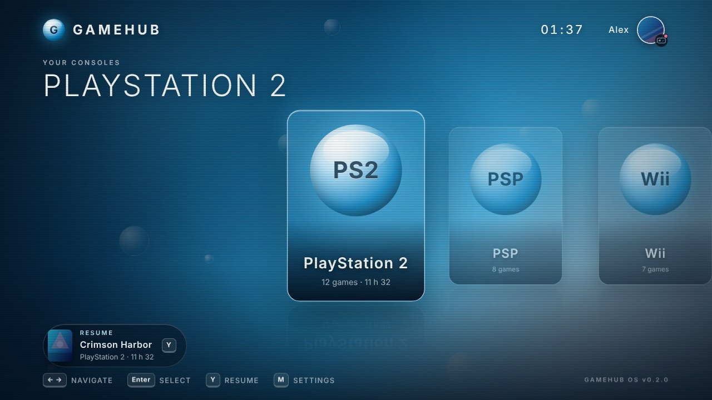
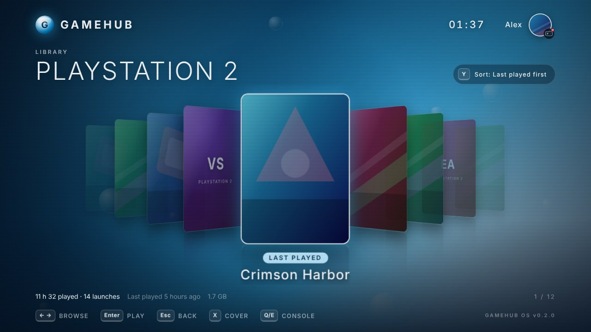

# GameHub

A console-style home screen for your emulators. Add your consoles once, and GameHub gives you a clean, gamepad-friendly library that starts the right emulator with the right game.

[Lire en français](README.fr.md)



## Features

- **One home screen for every console.** Each console keeps its own emulator, game folder and launch options.
- **Templates for popular emulators.** PlayStation 1/2/3, PSP, GameCube, Wii, Xbox 360, Nintendo 64/DS, Game Boy Advance and Super Nintendo come with sensible file types and launch options.
- **Your library builds itself.** GameHub scans your game folders, cleans up titles, hides the `.bin` files that belong to a `.cue` sheet and keeps multi-disc games apart.
- **Made for a gamepad and a keyboard.** Navigate everything with a controller, the keyboard or the mouse. The hints at the bottom switch to the device you use.
- **Covers, profile, stats.** Add your own cover art, a profile picture and banner, and see how long you play.
- **Four themes, two languages.** Ocean, Matrix, Cyberpunk and Midnight. English and French, picked from your system by default.
- **Safe by design.** The interface never sends a program path to the backend: it only asks to start "this game of this console". The emulator and its arguments always come from your saved settings, and game paths cannot leave the console folder.
- **Portable data.** Settings, covers and stats live in one folder you can copy to back up.



## Install

### From a release

Download the installer for your system from the [Releases](../../releases) page and run it.

GameHub does not include any game, BIOS or emulator. Install the emulators you want to use first, then add them in GameHub.

### From source

You need [Node.js 22.12 or newer](https://nodejs.org), [Rust](https://rustup.rs) and the [Tauri prerequisites](https://tauri.app/start/prerequisites/) for your system. Windows is the main target.

```bash
npm install
npm run tauri dev      # run the desktop app
npm run tauri build    # build an installer
```

`npm run dev` alone starts the interface in a normal browser with a demo backend and invented games. It is the fastest way to work on the design.

## First steps

1. Open GameHub and choose **Add a console**.
2. Pick a template (or **Custom**), then choose the emulator program and the folder that holds your games.
3. Press **Add console**. Your games appear in the library.
4. Select a game and press <kbd>Enter</kbd> (or **A** on a controller).

### Launch options

The launch options are the arguments passed to the emulator. Write `{rom}` where the game file should go:

```text
-batch -fullscreen -- {rom}
```

If `{rom}` is missing, the game path is added at the end. Quotes keep arguments that contain spaces together.

## Controls

| Action | Keyboard | Controller |
| --- | --- | --- |
| Move | Arrow keys or WASD | D-pad or left stick |
| Confirm | Enter | A |
| Back | Esc | B |
| Change cover / reset | X | X |
| Sort / resume last game | Y | Y |
| Previous / next console | Q / E | LB / RB |
| Settings | M | Start |
| Full screen | F11 or Alt+Enter | |

## Your data

Everything GameHub saves is in the `GameHub_Data` folder inside the application data folder of your system. On Windows that is `%LOCALAPPDATA%\com.gamehub.app\GameHub_Data`. **Settings → About → Data folder** opens it.

| File or folder | Content |
| --- | --- |
| `settings.json` | Profile, appearance and consoles |
| `stats.json` | Play time and last played |
| `Covers/` | Cover images you added |
| `Images/` | Avatar, banner and console pictures |

If `settings.json` is ever damaged, GameHub keeps it as `settings.corrupt.json` and starts again from a clean file.

## Project layout

```text
src/
  app/            Interface (TypeScript): screens, input, dialogs, texts
  pages/          The single Astro page that hosts the app
  styles/         Design tokens, base, components and screens
src-tauri/src/
  library.rs      Folder scan and title cleanup
  launch.rs       Starting an emulator safely
  store.rs        Settings and stats files
  presets.rs      Console templates
  images.rs       Covers, avatar and banner
  migrate.rs      Import of data from earlier versions
```

Run the Rust tests with `cargo test --manifest-path src-tauri/Cargo.toml`.

## Sounds

The three menu sounds in `public/sounds` are placeholders. Before you redistribute GameHub, make sure you have the right to share them, or replace them with your own files (same names: `move.mp3`, `select.mp3`, `back.mp3`).

## License

[MIT](LICENSE). GameHub is not affiliated with any console maker or emulator project. Names of consoles and emulators belong to their owners and are used only to describe compatibility.
